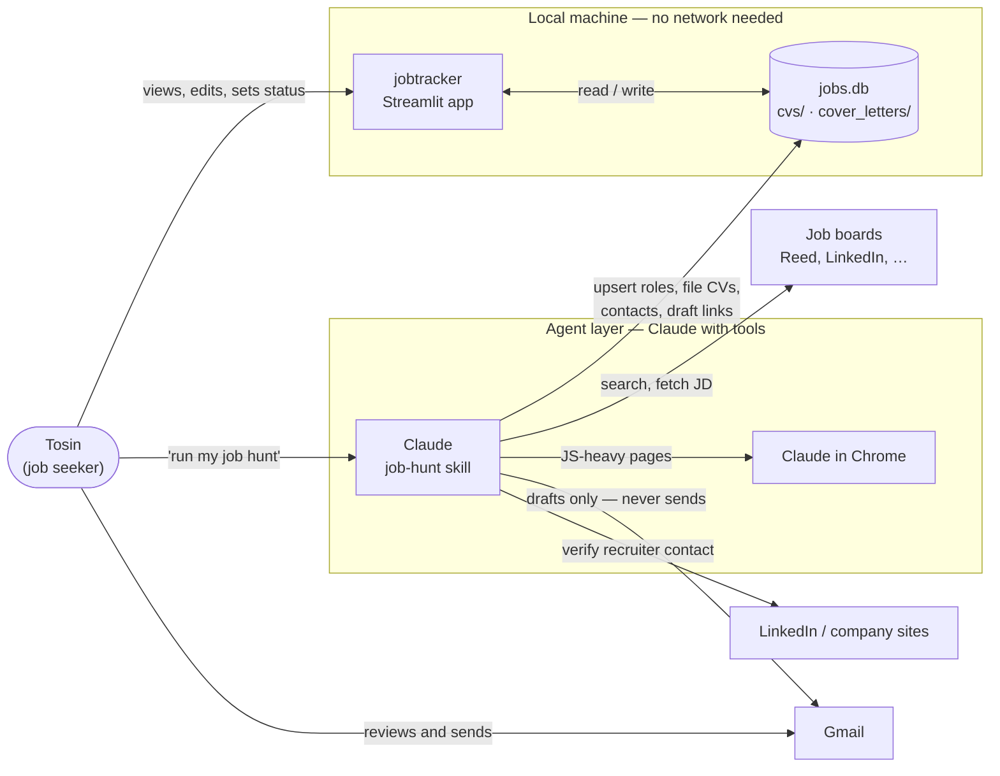

<!-- archdoc:manual -->

# Context (C4 level 1)

Who uses jobtracker and what it talks to. The dashed line is the capability
boundary from [ADR-002](decisions/ADR-002-the-app-is-decoupled-from-the-agent-connector-layer.md):
nothing on the left can reach anything on the right except through the database.

| Actor / system | Role | Boundary |
|---|---|---|
| Tosin | Single user. Reviews roles, sets status, sends emails. | Owns every outbound action ([ADR-003](decisions/ADR-003-gmail-integration-is-minimal-and-outbound-focused.md), [ADR-010](decisions/ADR-010-follow-up-emails-verified-contacts-a-2-working-day-queue.md)) |
| Streamlit app | Displays and edits the tracker; surfaces queues and metrics. | Local only: SQLite + filesystem. No LLM, no connectors ([ADR-001](decisions/ADR-001-local-first-single-user-sqlite-streamlit.md), [ADR-002](decisions/ADR-002-the-app-is-decoupled-from-the-agent-connector-layer.md)) |
| Claude (job-hunt skill) | Searches, scores, drafts CVs, resolves contacts, writes Gmail drafts. | Has web, Chrome, Gmail. Writes into `jobs.db` on the user's machine ([ADR-007](decisions/ADR-007-draft-cvs-on-demand-not-during-the-sweep.md)) |
| Job boards | Source of roles. | Read-only, via web fetch / Chrome |
| Gmail | Outbound follow-ups, inbound reply detection. | Agent creates *drafts*; the user sends |
| LinkedIn / company sites | Source of verified recruiter addresses. | Read-only; only verified addresses are stored |

Related decisions: [ADR-001](decisions/ADR-001-local-first-single-user-sqlite-streamlit.md), [ADR-002](decisions/ADR-002-the-app-is-decoupled-from-the-agent-connector-layer.md), [ADR-003](decisions/ADR-003-gmail-integration-is-minimal-and-outbound-focused.md)
