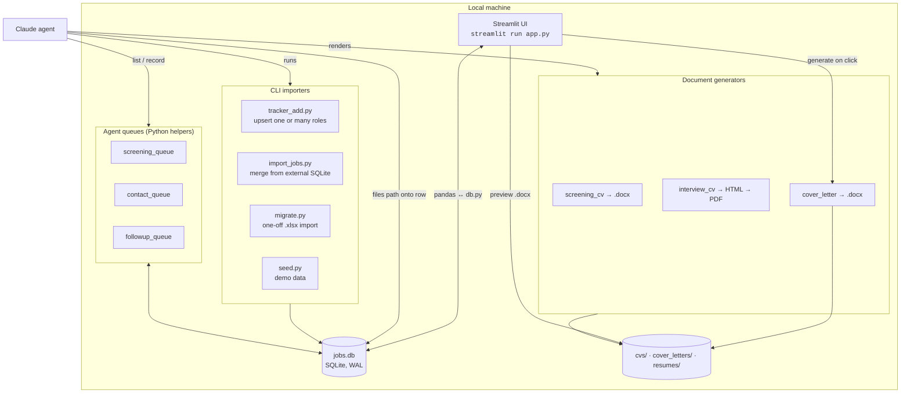

<!-- archdoc:manual -->

# Containers (C4 level 2)

The separately runnable pieces and the data that flows between them. All of
them live on the user's machine; the agent reaches them through a remote shell
when connected (see the job-hunt skill), and otherwise hands files back for
manual placement.

| Container | Technology | Responsibility | Runs how |
|---|---|---|---|
| Streamlit UI | Python, Streamlit, pandas | Grid editing, status changes, metrics, To-action / contact / follow-up / archive sections, CSV export, cover-letter button, CV preview | `streamlit run app.py` ([entry points](generated/entrypoints.md)) |
| CLI importers | Python, argparse | Bring roles in from outside: agent sweeps (`tracker_add`), another tracker DB (`import_jobs`), the original spreadsheet (`migrate`), demo data (`seed`). All upsert on `source_job_id` | `python <script>.py …` |
| Agent queues | Plain Python modules over `db` | Define what "needs work" means and file results back. The app only *marks* rows; the agent *processes* them | Imported by the agent in a one-off `python -c` or script |
| Document generators | python-docx; headless Chrome for PDF | Screening CV (ATS-safe), interview CV (designed), cover letter | Called by the agent (CVs) or the app (cover letter) |
| `jobs.db` | SQLite in WAL mode | Single source of truth, one `jobs` table ([schema](generated/schema.md)) | Path from `JOBTRACKER_DB` / `.env` |
| File folders | Filesystem | Generated documents; the DB stores only filenames/paths | Paths from `config.py` |

Why WAL: the app holds the DB open while the agent writes from another process —
[ADR-006](decisions/ADR-006-sqlite-in-wal-mode-configuration-via-environment.md).
Why the app never drafts anything itself: [ADR-007](decisions/ADR-007-draft-cvs-on-demand-not-during-the-sweep.md)
and [ADR-008](decisions/ADR-008-two-cvs-screening-vs-interview-the-screening-cv-is-jd.md).

Related decisions: [ADR-004](decisions/ADR-004-status-driven-pipeline-with-a-derived-to-action-queue.md), [ADR-005](decisions/ADR-005-de-duplicate-on-a-stable-job-id-importers-feed-the-database.md), [ADR-006](decisions/ADR-006-sqlite-in-wal-mode-configuration-via-environment.md)
