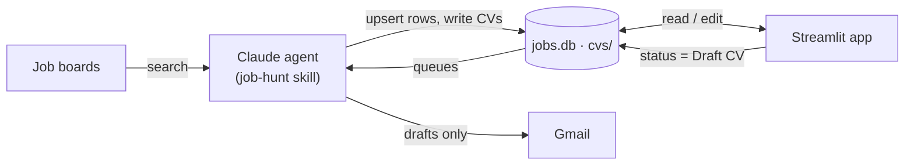

<!-- archdoc:manual -->

# jobtracker — architecture walkthrough

A local-first, single-user job application tracker. A **SQLite** file holds the
roles; a **Streamlit** page reads and edits them. Everything that needs the
outside world — searching job boards, reading a job description, resolving a
recruiter's email, drafting in Gmail — is done by **Claude acting as an agent**
(the `job-hunt` skill), which writes results into the same database for the app
to display. The one constraint that shapes everything: *the app cannot call an
LLM or a connector; the agent writes, the app shows* ([ADR-002](decisions/ADR-002-the-app-is-decoupled-from-the-agent-connector-layer.md)).

## How to read these docs

Top-down. Each page zooms in one level; stop when you have what you need.

| Step | Page | Answers |
|---|---|---|
| 1 | [Context](01-context.md) | Who uses it and what it talks to |
| 2 | [Containers](02-containers.md) | The runnable pieces and the data between them |
| 3 | [Components](03-components.md) | The modules inside, and how they depend on each other |
| 4 | [Workflows](#workflows) | How a role moves through the system, step by step |
| 5 | [Data schema](generated/schema.md) · [Status lifecycle](generated/states.md) | What is stored and how it changes |
| 6 | [Modules & symbols](generated/modules.md) · [Entry points](generated/entrypoints.md) | The reference layer |
| 7 | [Decisions](decisions/README.md) | Why it is built this way (ADR-001 … ADR-011) |

## Workflows

In the order a role experiences them:

1. [Job sweep](workflows/job-sweep.md) — agent searches boards, dedupes against the tracker, scores, logs new roles.
2. [Screening CV queue](workflows/screening-cv-queue.md) — user marks a role *Draft CV*; agent reads the JD and files an ATS-safe CV.
3. [Contact resolution and follow-up](workflows/contact-followup.md) — after applying: find a verified recruiter address, then draft (never send) a follow-up two working days later.
4. [Archive](workflows/archive.md) — closed roles leave the active views but are never deleted.

## The five-second version

## Keeping this current

- `generated/` is produced by `archdoc.py all` — never edit by hand; regenerate in
  the same commit as the code change.
- Pages marked `<!-- archdoc:manual -->` are written by hand; update them when a
  workflow or boundary changes, and add an ADR (from
  [the template](decisions/ADR-template.md)) when a decision changes.
- `archdoc.py build` renders everything into `build/index.html` — one file you can
  open, send, or present from.
