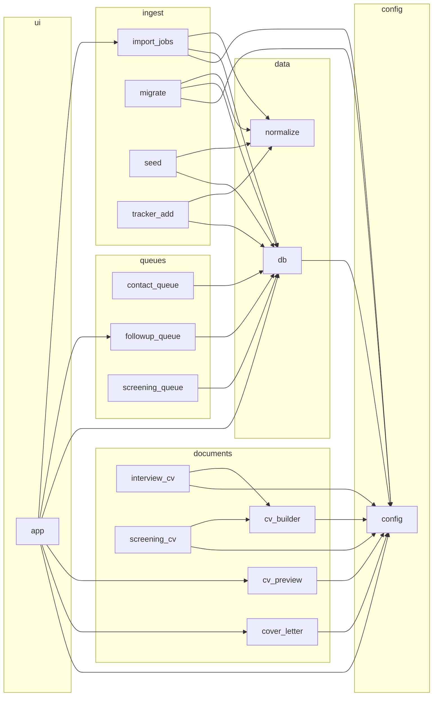

<!-- generated by archdoc: do not edit -->

# Module dependencies

Arrows point from the importing module to the module it depends on. Groups are the layers declared in `archdoc.json`.

## Layers

| Layer | Modules |
|---|---|
| ui | `app` |
| config | `config` |
| queues | `contact_queue`, `followup_queue`, `screening_queue` |
| documents | `cover_letter`, `cv_builder`, `cv_preview`, `interview_cv`, `screening_cv` |
| data | `db`, `normalize` |
| ingest | `import_jobs`, `migrate`, `seed`, `tracker_add` |

## Edges

| From | To | Names used |
|---|---|---|
| `app` | `config` | (module) |
| `app` | `cover_letter` | (module) |
| `app` | `cv_preview` | (module) |
| `app` | `db` | (module) |
| `app` | `followup_queue` | (module) |
| `app` | `import_jobs` | (module) |
| `contact_queue` | `db` | (module) |
| `cover_letter` | `config` | (module) |
| `cv_builder` | `config` | (module) |
| `cv_preview` | `config` | (module) |
| `db` | `config` | `DB_PATH` |
| `followup_queue` | `db` | (module) |
| `import_jobs` | `config` | (module) |
| `import_jobs` | `db` | (module) |
| `import_jobs` | `normalize` | `norm_status`, `parse_job_id`, `tc_key` |
| `interview_cv` | `config` | (module) |
| `interview_cv` | `cv_builder` | `detect_sector`, `load_profile`, `resolve_profile` |
| `migrate` | `config` | (module) |
| `migrate` | `db` | (module) |
| `migrate` | `normalize` | `clean`, `norm_date`, `norm_status`, `parse_job_id`, `tc_key` |
| `screening_cv` | `config` | (module) |
| `screening_cv` | `cv_builder` | `load_profile` |
| `screening_queue` | `db` | (module) |
| `seed` | `db` | (module) |
| `seed` | `normalize` | `clean`, `norm_date`, `norm_status`, `parse_job_id` |
| `tracker_add` | `db` | (module) |
| `tracker_add` | `normalize` | `clean`, `norm_date`, `norm_status`, `parse_job_id` |
