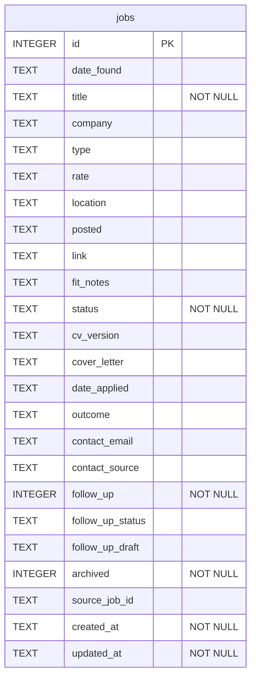

<!-- generated by archdoc: do not edit -->

# Data schema

## `jobs`

| Column | Type | Constraints |
|---|---|---|
| `id` | INTEGER | PK |
| `date_found` | TEXT |  |
| `title` | TEXT | NOT NULL |
| `company` | TEXT |  |
| `type` | TEXT |  |
| `rate` | TEXT |  |
| `location` | TEXT |  |
| `posted` | TEXT |  |
| `link` | TEXT |  |
| `fit_notes` | TEXT |  |
| `status` | TEXT | NOT NULL |
| `cv_version` | TEXT |  |
| `cover_letter` | TEXT |  |
| `date_applied` | TEXT |  |
| `outcome` | TEXT |  |
| `contact_email` | TEXT |  |
| `contact_source` | TEXT |  |
| `follow_up` | INTEGER | NOT NULL |
| `follow_up_status` | TEXT |  |
| `follow_up_draft` | TEXT |  |
| `archived` | INTEGER | NOT NULL |
| `source_job_id` | TEXT |  |
| `created_at` | TEXT | NOT NULL |
| `updated_at` | TEXT | NOT NULL |
