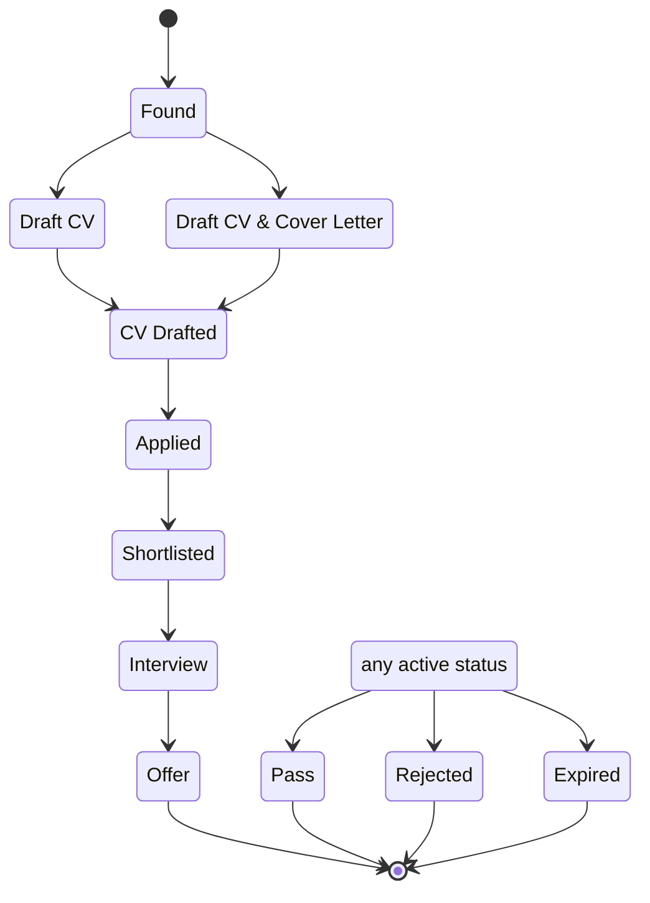

<!-- generated by archdoc: do not edit -->

# Status lifecycle

Values of `status` in declaration order; transitions are declared in `archdoc.json` (they are a product decision, not derivable from code).

| # | Status |
|---|---|
| 1 | Found |
| 2 | Draft CV |
| 3 | Draft CV & Cover Letter |
| 4 | CV Drafted |
| 5 | Applied |
| 6 | Shortlisted |
| 7 | Interview |
| 8 | Offer |
| 9 | Pass |
| 10 | Rejected |
| 11 | Expired |

## Notes

- **archived** — Orthogonal boolean flag, not a status: ended/closed roles are hidden from the main grid but kept (ADR-011).
- **Pass / Rejected / Expired** — Terminal outcomes reachable from any active status.
