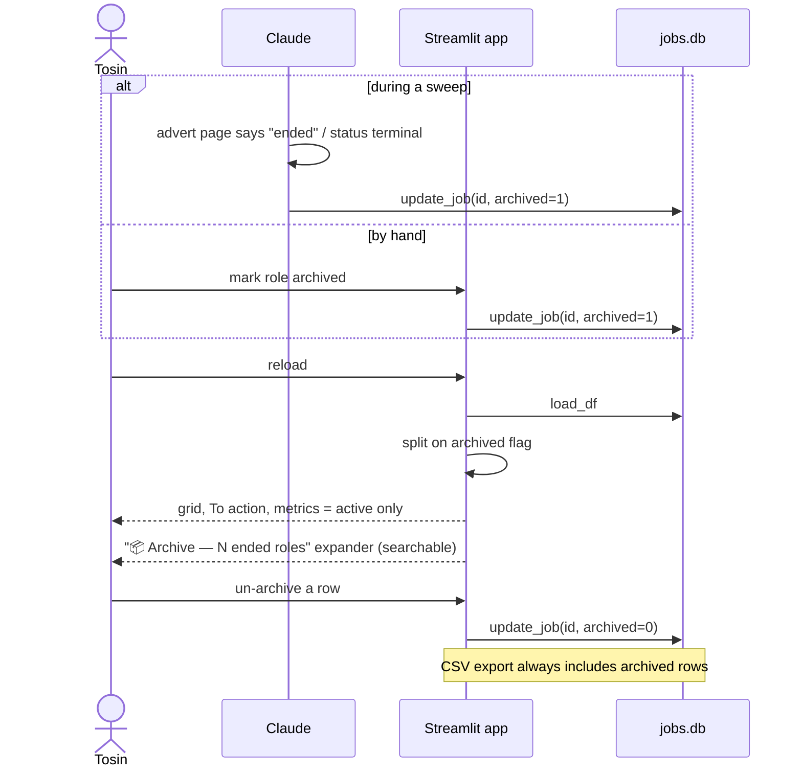

<!-- archdoc:manual -->

# Workflow: archive

**Purpose.** Keep the active views focused on live opportunities without ever
losing a record — a recruiter may call back about a closed role.

**Actors.** Tosin, Claude (during a sweep, when an advert has ended), Streamlit
app, `jobs.db`.

**Trigger.** A vacancy has ended, or the status is terminal (Pass / Rejected /
Expired). Live-stage roles (Shortlisted / Interview / Offer) stay active even if
the advert closed.

## Steps

1. `archived` is an app-managed `APP_COLUMNS` flag, so importers ignore it and a
   re-run sweep cannot un-archive a role.
2. `app.py` splits `df` into active/archived once on load; every active view
   (grid, To action, metrics, queues) operates on the active frame only.
3. Archive is reversible from the expander; nothing is deleted.

## Files

| Step | Code |
|---|---|
| Flag | `db.APP_COLUMNS` (`archived`), `db._ensure_columns` |
| Split | `_arch_mask` / `archived_df` near the top of `app.py` |
| Section | the `📦 Archive` expander at the bottom of `app.py` |

## Related decisions

- [ADR-011 — archive for ended/closed roles (not deletion)](../decisions/ADR-011-archive-for-ended-closed-roles-not-deletion.md)
- [ADR-004 — status-driven pipeline](../decisions/ADR-004-status-driven-pipeline-with-a-derived-to-action-queue.md)
