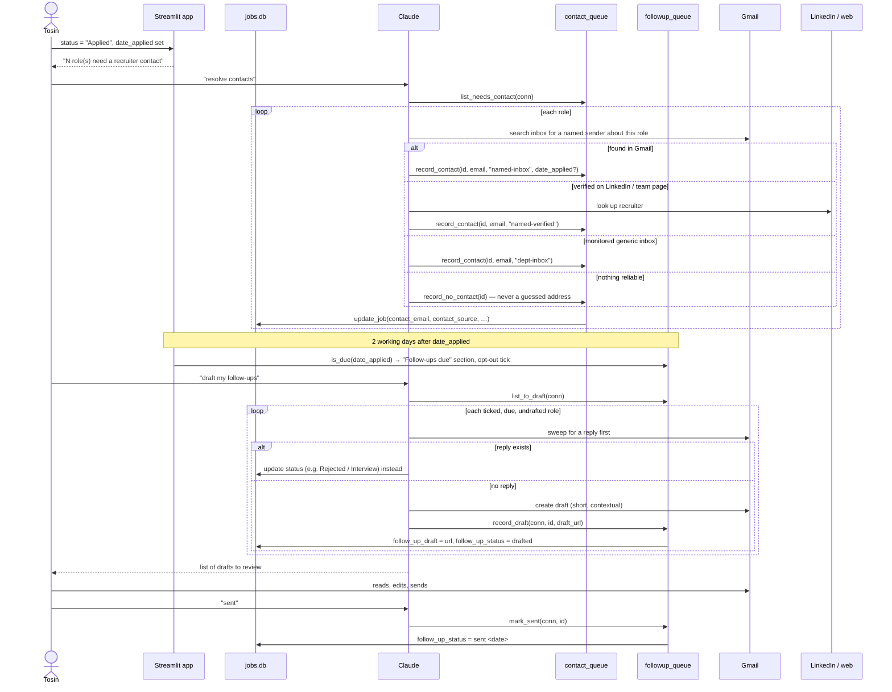

<!-- archdoc:manual -->

# Workflow: contact resolution and follow-up

**Purpose.** After applying, nudge the application forward with a short, timely
email — only to a *verified* recruiter address, and only ever as a Gmail draft
the user sends themselves.

**Actors.** Tosin, Streamlit app, `contact_queue`, `followup_queue`, Claude,
Gmail, LinkedIn / company sites.

**Trigger.** A role reaches **Applied** (or later) with no `contact_email`
(contact queue); then `date_applied` + 2 working days (follow-up queue).

## Steps

1. **Contact resolution** walks a best-first ladder: Gmail named sender →
   verified LinkedIn/team page → monitored department inbox → none. Only verified
   addresses are ever written; `record_no_contact` stops a role re-queuing.
2. **Due rule** lives in one place — `followup_queue.is_due` — and the app imports
   it, so the metric and the agent can never disagree.
3. **Opt-out, not opt-in**: `follow_up` starts at 0 (shown ticked); the user
   unticks to skip.
4. **Reply beats nudge**: Claude checks Gmail before drafting; a rejection
   changes status rather than producing a follow-up.
5. **Drafts only.** The user sends from Gmail and confirms; `mark_sent` settles it.

## Files

| Step | Code |
|---|---|
| Contact queue | `contact_queue.NEEDS_CONTACT_STATUSES`, `CONTACT_SOURCES`, `list_needs_contact`, `record_contact`, `record_no_contact` |
| Due rule | `followup_queue.WORKING_DAY_LAG`, `add_working_days`, `is_due` |
| Follow-up queue | `followup_queue.list_due`, `list_to_draft`, `record_draft`, `mark_sent` |
| App sections | contact expander and "Follow-ups due" section in `app.py`; `_follow_up_due_mask` |
| Tests | `tests/test_contact_queue.py`, `tests/test_followup_queue.py` |

## Related decisions

- [ADR-003 — Gmail integration is minimal and outbound-focused](../decisions/ADR-003-gmail-integration-is-minimal-and-outbound-focused.md)
- [ADR-010 — verified contacts, a 2-working-day queue, drafts only](../decisions/ADR-010-follow-up-emails-verified-contacts-a-2-working-day-queue.md)
