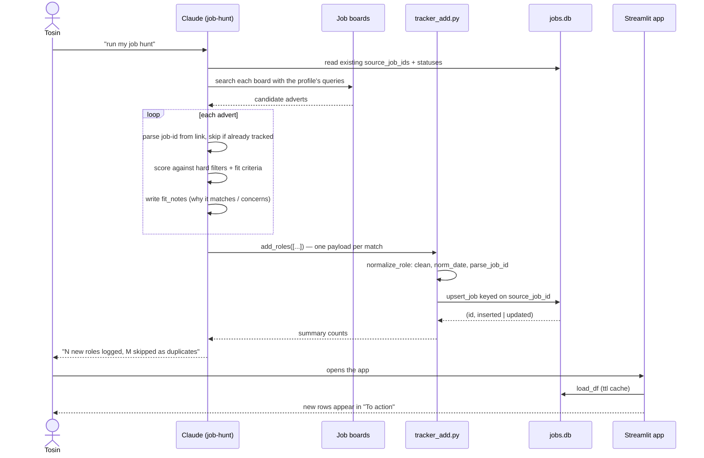

<!-- archdoc:manual -->

# Workflow: job sweep

**Purpose.** Find new roles on the boards, ignore anything already tracked,
score the rest against the profile, and log the matches — safely re-runnable
daily.

**Actors.** Tosin (triggers), Claude with the `job-hunt` skill (does the work),
job boards, `tracker_add.py` / `db.upsert_job`, the Streamlit app (shows the
result).

**Trigger.** "Run my job hunt" / "anything new on Reed" — or a scheduled routine.

## Steps

1. **Cross-reference first.** The skill reads the tracker before searching so it
   never re-processes a role and never overwrites a hand-edited status.
2. **Search and score.** Web fetch / Chrome for each board; hard filters
   (location, rate, type) then a fit score with a short `fit_notes` rationale.
3. **Log.** `tracker_add.add_roles` → `normalize_role` → `db.upsert_job`. A
   known `source_job_id` updates in place; unknown inserts with `status='Found'`.
   `APP_COLUMNS` are never touched by importers.
4. **No documents yet.** CVs are *not* drafted during the sweep — the user
   decides which roles deserve one ([ADR-007](../decisions/ADR-007-draft-cvs-on-demand-not-during-the-sweep.md)).

## Files

| Step | Code |
|---|---|
| Skill definition | `SKILL.md` (job-hunt) |
| Normalise + upsert | `tracker_add.normalize_role`, `tracker_add.add_roles`, `db.upsert_job`, `normalize.parse_job_id` |
| Alternative ingest | `import_jobs.import_jobs` (merge another tracker DB), `migrate.py` (spreadsheet) |
| Display | `app.load_df`, the "To action" section in `app.py` |

## Related decisions

- [ADR-002 — decoupled agent layer](../decisions/ADR-002-the-app-is-decoupled-from-the-agent-connector-layer.md)
- [ADR-005 — de-duplicate on a stable job-id](../decisions/ADR-005-de-duplicate-on-a-stable-job-id-importers-feed-the-database.md)
- [ADR-007 — draft CVs on demand](../decisions/ADR-007-draft-cvs-on-demand-not-during-the-sweep.md)
