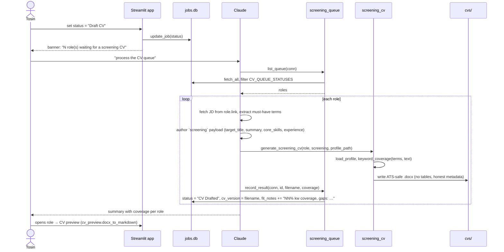

<!-- archdoc:manual -->

# Workflow: screening CV queue

**Purpose.** Produce an ATS-safe, keyword-mirrored CV for a role the user has
chosen to pursue, without the app needing an LLM.

**Actors.** Tosin, Streamlit app, `screening_queue`, Claude, `screening_cv`,
`jobs.db`, `cvs/`.

**Trigger.** User sets a role's status to **Draft CV** or **Draft CV & Cover
Letter** in the grid. That status *is* the queue ([ADR-004](../decisions/ADR-004-status-driven-pipeline-with-a-derived-to-action-queue.md)).

## Steps

1. The app writes only a status. It cannot read the JD or call a model.
2. `screening_queue.list_queue` derives the queue from `status`.
3. Claude fetches the JD, writes the JD-mirroring content, renders through
   `screening_cv.generate_screening_cv` — deliberately plain (no tables/columns)
   so ATS parsers read it, with the candidate stamped as document author.
4. `record_result` settles the role to **CV Drafted** and makes the keyword
   coverage visible in `fit_notes`.
5. Later, for interviews, `interview_cv.generate_interview_cv` renders a designed
   HTML→PDF from the same profile + screening payload ([ADR-009](../decisions/ADR-009-interview-cv-a-designed-html-pdf-built-in-house.md)).

## Files

| Step | Code |
|---|---|
| Queue | `screening_queue.CV_QUEUE_STATUSES`, `list_queue`, `record_result` |
| Render | `screening_cv.generate_screening_cv`, `screening_cv.keyword_coverage`, `cv_builder.load_profile` |
| Interview CV | `interview_cv.render_html`, `interview_cv.generate_interview_cv` |
| Preview | `cv_preview.find_cv`, `cv_preview.docx_to_markdown` |
| Tests | `tests/test_screening_queue.py`, `tests/test_screening_cv.py`, `tests/test_cv_builder.py` |

## Related decisions

- [ADR-004 — status-driven pipeline](../decisions/ADR-004-status-driven-pipeline-with-a-derived-to-action-queue.md)
- [ADR-008 — two CVs; the screening CV is JD-driven via an agent queue](../decisions/ADR-008-two-cvs-screening-vs-interview-the-screening-cv-is-jd.md)
- [ADR-009 — interview CV as designed HTML→PDF](../decisions/ADR-009-interview-cv-a-designed-html-pdf-built-in-house.md)
